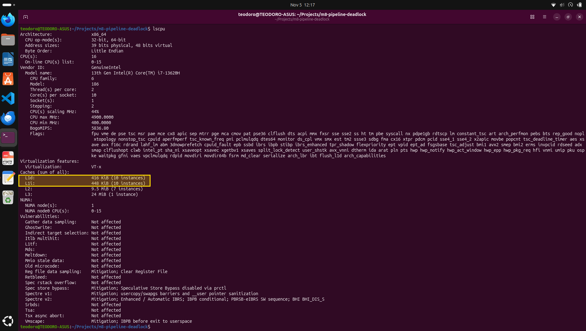
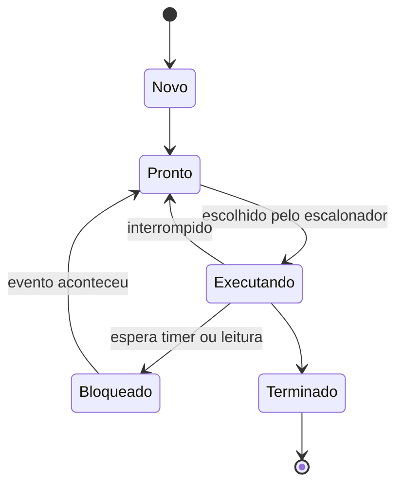
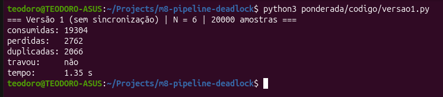
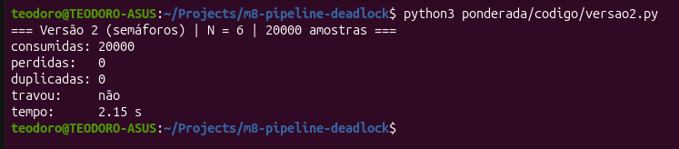
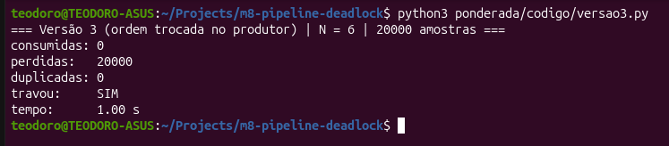
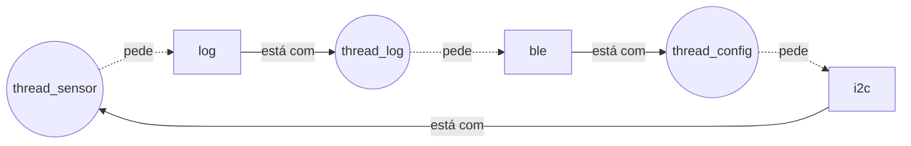

Nome: Teodoro Borges de Carvalho Neira | D1 = 7 | D2 = 8 | N = 6

# Ponderada CC08: do pipeline ao deadlock (Tato)

## Parâmetros

Letras: Teodoro (7) + Borges (6) + de (2) + Carvalho (8) + Neira (5) = 28.

- D1 = 7 (letras do primeiro nome)
- D2 = 8 (último dígito de 28)
- IC = 100.000 + 20.000 × 8 = 260.000 instruções por amostra
- m = 3% + 0,5% × 7 = 6,5%
- N = 3 + (8 mod 5) = 6 posições

Requisito: cada amostra tem que ser processada em até 5 ms.

---

# Parte A: o problema técnico

## A1. Qual processador vai na pulseira?

### A1.1 Plataforma H

```
Ciclos = 260.000 × 1,5 = 390.000
Tempo  = 390.000 / 48.000.000 = 8,125 ms
```

8,125 ms é maior que 5 ms. Não atende.

### A1.2 Plataforma V

```
AMAT   = 1 + 0,065 × 120 = 8,8 ciclos
CPI    = 1,0 + 1,3 × 0,065 × 120 = 11,14
Ciclos = 260.000 × 11,14 = 2.896.400
Tempo  = 2.896.400 / 1.200.000.000 = 2,41 ms
Pior caso = 2,41 + 3 (atraso do Linux) = 5,41 ms
```

Na média atende, mas no pior caso passa de 5 ms. Como o limite vale para toda amostra, não atende.

### A1.3 Plataforma H com DSP (Lei de Amdahl)

```
Speedup = 1 / (0,40 + 0,60 / 5) = 1 / 0,52 = 1,92
Novo tempo = 8,125 × 0,52 = 4,225 ms
```

Agora atende, com sobra de 0,775 ms. Como a H não tem sistema operacional nem cache, esse tempo é sempre o mesmo.

### A1.4 Por que a V precisa de cache e a H não?

Na V (Von Neumann), instruções e dados usam o mesmo caminho até a mesma memória, e a DRAM demora 120 ciclos. Sem cache, o processador passaria quase todo o tempo esperando a memória: esse é o gargalo de Von Neumann. A H (Harvard) tem caminhos separados para instruções e dados, e a memória interna responde em 1 ciclo. Como a memória acompanha o processador, não há espera a esconder.

### A1.5 Evidência da minha máquina



A L1 é dividida: L1d (dados, 416 KiB) e L1i (instruções, 448 KiB). Só que a L2, a L3 e a RAM guardam instruções e dados juntos. Por isso o computador é Von Neumann, com uma separação no estilo Harvard só no primeiro nível de cache, para diminuir a espera pela memória.

---

## A2. Pipeline: o loop do filtro

```
I1  lw   x5, 0(x10)
I2  add  x6, x6, x5
I3  lw   x7, 0(x11)
I4  sub  x6, x6, x7
I5  sw   x6, 0(x12)
I6  addi x10, x10, 4
I7  addi x11, x11, 4
```

### A2.1 Dependências (RAW)

| Quem depende | De quem | Registrador |
|---|---|---|
| I2 | I1 (lw) | x5 |
| I4 | I2 | x6 |
| I4 | I3 (lw) | x7 |
| I5 | I4 | x6 |

### A2.2 Sem forwarding

A instrução só pode ler o registrador no mesmo ciclo em que a anterior escreve (WB). Ciclos entre parênteses são esperas (bolhas).

| Instr. | 1 | 2 | 3 | 4 | 5 | 6 | 7 | 8 | 9 | 10 | 11 | 12 | 13 | 14 | 15 | 16 | 17 |
|---|---|---|---|---|---|---|---|---|---|---|---|---|---|---|---|---|---|
| I1 | IF | ID | EX | MEM | WB | | | | | | | | | | | | |
| I2 | | IF | (ID) | (ID) | ID | EX | MEM | WB | | | | | | | | | |
| I3 | | | IF | (IF) | (IF) | ID | EX | MEM | WB | | | | | | | | |
| I4 | | | | | | IF | (ID) | (ID) | ID | EX | MEM | WB | | | | | |
| I5 | | | | | | | IF | (IF) | (IF) | (ID) | (ID) | ID | EX | MEM | WB | | |
| I6 | | | | | | | | | | IF | (IF) | (IF) | ID | EX | MEM | WB | |
| I7 | | | | | | | | | | | | | IF | ID | EX | MEM | WB |

Total: 11 ciclos + 6 bolhas = 17 ciclos.

### A2.3 Com forwarding

| Instr. | 1 | 2 | 3 | 4 | 5 | 6 | 7 | 8 | 9 | 10 | 11 | 12 | 13 |
|---|---|---|---|---|---|---|---|---|---|---|---|---|---|
| I1 | IF | ID | EX | MEM | WB | | | | | | | | |
| I2 | | IF | ID | (ID) | EX | MEM | WB | | | | | | |
| I3 | | | IF | (IF) | ID | EX | MEM | WB | | | | | |
| I4 | | | | | IF | ID | (ID) | EX | MEM | WB | | | |
| I5 | | | | | | IF | (IF) | ID | EX | MEM | WB | | |
| I6 | | | | | | | | IF | ID | EX | MEM | WB | |
| I7 | | | | | | | | | IF | ID | EX | MEM | WB |

Total: 11 ciclos + 2 bolhas = 13 ciclos.

As bolhas que sobram vêm dos dois lw seguidos de uso (I1 → I2 e I3 → I4). O lw só tem o valor no fim do estágio MEM, e a próxima instrução precisaria dele no mesmo ciclo. O forwarding não consegue adiantar um valor que ainda não existe.

### A2.4 Reordenando

```
lw   x5, 0(x10)
lw   x7, 0(x11)
add  x6, x6, x5
sub  x6, x6, x7
sw   x6, 0(x12)
addi x10, x10, 4
addi x11, x11, 4
```

Agora cada valor carregado só é usado duas instruções depois, então não há bolhas. O resultado é o mesmo, porque nenhuma instrução movida depende das outras.

Total: 5 + 6 = 11 ciclos.

---

## A3. Processos e threads

### A3.1 Organização

- Processo 1, com três threads: sensor, processamento e motor. Elas trocam dados a cada 10 ms. Como threads, usam a mesma memória sem precisar copiar nada, e criar uma thread ou trocar entre elas é bem mais barato do que fazer o mesmo com processos.
- Processo 2: BLE. Ele não tem prazo apertado e fala com o mundo de fora. Separado, se ele travar ou cair, a vibração continua funcionando. Conversa com o processo 1 por troca de mensagens.

### A3.2 BLE invadido: thread ou processo?

Se o BLE fosse uma thread, quem invadisse teria acesso à memória do processo principal e poderia desligar o motor ou mandar avisos falsos. Como processo separado, o sistema operacional impede esse acesso. O invasor só consegue mandar mensagens, e o processo principal confere cada uma antes de usar.

### A3.3 Estados de um processo



A thread do sensor passa quase todo o tempo em Bloqueado. A leitura dura microssegundos, e no resto dos 10 ms ela fica esperando o timer da próxima amostra.

---

## A4. Buffer com semáforos

O código está em [`codigo/`](codigo/) (Python, N = 6, 20.000 amostras). Para rodar, veja o [README](../README.md).

### Resultados

| Versão | Execução | Consumidas | Perdidas | Duplicadas | Travou? |
|---|---|---|---|---|---|
| 1 | 1 | 19.304 | 2.762 | 2.066 | não |
| 1 | 2 | 20.459 | 2.351 | 2.810 | sim |
| 1 | 3 | 19.833 | 2.628 | 2.461 | sim |
| 2 | 1 | 20.000 | 0 | 0 | não |
| 2 | 2 | 20.000 | 0 | 0 | não |
| 2 | 3 | 20.000 | 0 | 0 | não |
| 3 | 1 | 0 | 20.000 | 0 | sim |
| 3 | 2 | 0 | 20.000 | 0 | sim |
| 3 | 3 | 0 | 20.000 | 0 | sim |

Na versão 3, as amostras contam como perdidas porque nunca chegaram ao motor. A execução 1 de cada versão é a dos prints.

### Prints







### Versão 1: por que perde e duplica

A região crítica é a atualização do contador:

```python
lido = contador
time.sleep(0)       # a thread é interrompida aqui
contador = lido + 1
```

Se o produtor lê o contador e é interrompido, o consumidor pode mudar o valor nesse meio-tempo. Quando o produtor volta, escreve em cima com um valor velho, e a mudança do consumidor se perde. Se o contador fica maior do que devia, o consumidor lê posições antigas (duplicadas). Se fica menor, o produtor escreve por cima de amostras ainda não lidas (perdidas). Às vezes o contador fica num valor em que os dois ficam esperando para sempre, e o programa trava.

### Versão 2: o que cada semáforo garante

- vazio: o produtor só escreve se houver posição livre. Nenhuma amostra é sobrescrita.
- cheio: o motor só lê se houver amostra nova. Nada é lido duas vezes.
- mutex: só uma thread mexe no buffer por vez.

### Versão 3: o que aconteceu

Travou nas três execuções. O produtor encheu o buffer e, na amostra seguinte, pegou o mutex antes de esperar uma posição livre. Ficou parado segurando o mutex. O consumidor precisava do mutex para liberar uma posição, então os dois ficaram esperando um pelo outro: deadlock.

---

## A5. Deadlock: a pulseira congelou

### A5.1 Como acontece

1. thread_sensor pega o i2c.
2. thread_log pega o log.
3. thread_config pega o ble.
4. thread_sensor tenta pegar o log e espera.
5. thread_log tenta pegar o ble e espera.
6. thread_config tenta pegar o i2c e espera.

Cada uma segura um recurso e espera o da outra. Ninguém avança.



### A5.2 As quatro condições

| Condição | No código |
|---|---|
| Exclusão mútua | Cada recurso só pode ser usado por uma thread por vez. |
| Segurar e esperar | Cada thread segura o primeiro recurso enquanto espera o segundo. |
| Sem preempção | Ninguém tira um recurso de uma thread. Só ela mesma libera. |
| Espera circular | sensor espera log, log espera ble, config espera i2c: forma um ciclo. |

### A5.3 Duas correções

Prevenção: cada thread solta o primeiro recurso antes de pegar o segundo (por exemplo, o sensor faz V(i2c) antes de P(log)). Assim ninguém segura dois recursos ao mesmo tempo, e o deadlock não acontece. Para o usuário, nada muda: a pulseira só deixa de travar.

Detecção e recuperação: um watchdog verifica se o sensor está produzindo amostras. Se ficar, por exemplo, 50 ms sem amostra, ele reinicia as threads de log e config ou, se não resolver, a pulseira inteira. Para o usuário, o travamento vira uma pausa de alguns segundos sem vibração, avisada por um pulso longo. É mais rápido de fazer, mas o problema continua podendo acontecer.

---

# Parte B: a decisão do CTO

## Memorando ao conselho da Tato: qual processador vai para a produção (Dilema 2)

Decisão: vamos produzir com a Plataforma H com o acelerador DSP, a R$ 37 por unidade.

Por quê. A pulseira precisa processar cada amostra em até 5 ms. Pelas contas da Parte A:

| Opção | Pior caso | Atende? | Custo |
|---|---|---|---|
| H sem DSP | 8,13 ms | não | R$ 22 |
| H + DSP | 4,23 ms | sim | R$ 37 |
| V (Linux) | 5,41 ms | não | R$ 70 |

A V é mais rápida na média (2,41 ms), mas o Linux pode atrasar até 3 ms, e aí ela passa do limite. Para quem não enxerga, "funciona na média" significa que em algum momento o aviso de um poste não chega. A H + DSP leva sempre 4,23 ms, e esse foi o número que mais pesou. Ela ainda custa R$ 33 a menos por unidade.

Do que abrimos mão. Na H, o firmware só é atualizado com cabo, na assistência técnica. Quem paga é o usuário, que precisa ir até lá, e a empresa, com a logística. A sobra de tempo também é pequena (0,77 ms), então funções novas vão exigir otimização ou outro hardware.

Impacto no usuário e segurança. A pulseira fica previsível: sem sistema operacional, não há travadas nem pausas. Há menos portas para ataque, porque não tem Linux nem atualização pela internet. Em compensação, se aparecer uma falha no BLE, ela só é corrigida quando o usuário for à assistência. Para reduzir esse risco, o BLE vai aceitar só uma lista pequena de comandos, e o firmware vai ser assinado.

O que me faria mudar de ideia. Se um teste de 72 horas da Plataforma V com Linux de tempo real mostrar atraso máximo abaixo de 2,5 ms, ela passa a cumprir os 5 ms (2,41 + 2,5 < 5). Aí a atualização pela internet compensa os R$ 33 a mais.
